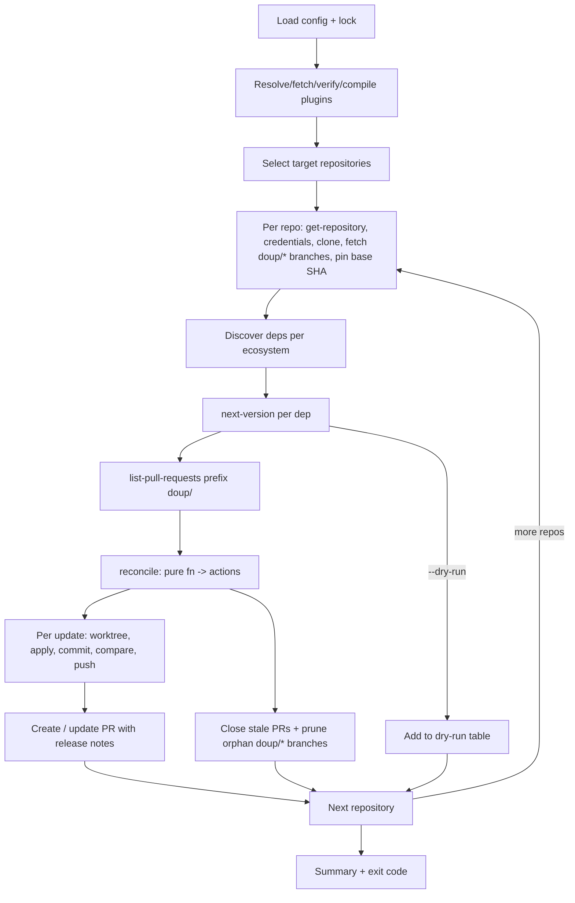

# Implementation Plan: `doup update`

Status: **Ready for implementation**. All open questions are resolved; see [Decisions](#decisions).

## Goal

Make `doup update` feature complete. Like Renovate, **doup is responsible for the repositories it updates**: it clones
each target repo itself, works in that clone, and pushes from it. It does not depend on, read, or modify any checkout
the user or CI happens to have. It should:

1. Load the runner config (`doup.yaml` / `doup.json`).
2. Resolve, download, verify and lock the platform and ecosystem plugins.
3. Work out the target repositories. By default this is the repo the config file lives in.
4. For each repository:
   1. Clone it through the platform plugin.
   2. Ask each ecosystem plugin which dependencies exist and which ones are out of date.
   3. For each outdated dependency, apply the update in an isolated git worktree, then commit and push a branch.
   4. Ask the platform plugin to create, update or close pull requests so the repo matches the desired state.

`--dry-run` stops after 4.2 and prints a table. `--local <dir>` runs a dry run against a local directory, with no clone
and no platform calls.

### In scope

- WIT contracts for **ecosystem** and **platform** plugins (replacing the calculator toy).
- Host runtime: wasmtime, WASI p2, wasi:http, logging, timeouts and memory limits.
- Config discovery, parsing and normalisation. The schema changes are listed below.
- Plugin resolution from wkg registries and local files, a cache, and `doup.lock`.
- Repository acquisition: target selection, authenticated cloning through the platform plugin, pluggable clone
  strategies.
- Git orchestration: worktrees, commits, force-with-lease pushes, and stale branch cleanup.
- PR reconciliation: create, update in place, close when no longer needed.
- Fixture plugins and integration tests.

### Out of scope

- The `init` and `self-update` subcommands.
- Real platform plugins (GitHub, …) and real ecosystem plugins (npm, …).
- Grouping, filtering, rate limiting, schedules.
- Configurable branch, commit and PR templates. Defaults are hardcoded for now.
- Per-plugin network allow-lists. Network access is unrestricted in v1; an allow-list is noted as future work.
- Parallel execution. v1 runs sequentially (repos one after another, updates one after another).
- Publishing the `doup:plugin` WIT package to a registry.
- Per-repository config files (Renovate-style two-tier config), repository autodiscovery, SSH remotes, and signed
  commits. All are noted under future work.

---

## Corrections & Rust/WASM notes on the original sketch

These are the places where the rough notes in [update.rs](../../projects/cli/src/commands/update.rs) would run into
trouble.

### 1. Don't pass `working_dir` as a string to the plugin

A WASI guest has no access to the host filesystem. It can only see directories the host _preopens_ for it, and only
under a guest path the host picks. A host path like `/home/brad/repo` means nothing inside the sandbox.

Instead, the host preopens the target directory at a fixed guest path, **`/workspace`**, when it builds the `WasiCtx`
for that call. Plugins always read `/workspace/package.json` and so on. This also lets us apply **least privilege**:

| Call                                                 | `/workspace` permissions |
| ---------------------------------------------------- | ------------------------ |
| `list-dependencies`, `next-version`, `release-notes` | read-only                |
| `apply-update`                                       | read-write (worktree)    |
| platform calls                                       | **no filesystem at all** |

### 2. "Untyped bag of config" → JSON string

WIT has no `any` or dynamic type. Every value crossing the boundary must have a concrete WIT type. The usual pattern is
to pass plugin config as a **JSON-encoded string**. Each plugin then deserialises it into its own
`#[derive(Deserialize)] struct Config` with `serde_json`. The host never needs to understand it.

### 3. Versions are opaque strings to the host

Semver, PEP 440, calver, Go pseudo-versions and git SHAs all have different rules, which is why versioning lives inside
the ecosystem plugin. So the host **never parses** dependency versions. It only displays them and compares them for
equality.

### 4. `generate_update_diff` → `apply-update`

The plugin should just **mutate files** in `/workspace`. The host already has git, so it computes the diff with `git
status` / `git diff`. That keeps plugins simpler and avoids each plugin producing its own patch format.

### 5. Rebasing: don't rebase, rebuild

The host should not rebase existing doup branches. On every run it should **recreate the branch from the current base**
(`origin/<base>`), re-apply the update, and compare the resulting _tree_ with the remote branch. If they differ, or the
parent is stale, it force-pushes with `--force-with-lease`. This never produces merge conflicts, it is deterministic,
and it is how Renovate behaves in practice.

### 6. Go async from the start

- `wasm-pkg-client` (the library behind `wkg`) is async and uses tokio.
- `wasmtime-wasi-http` is built on tokio and hyper.
- Calling wasmtime's _sync_ WASI APIs from inside a tokio runtime can panic ("cannot start a runtime from within a
  runtime").

So use `#[tokio::main]` and run wasmtime in **async mode** (`Config::async_support(true)` and async bindgen). In Rust,
async is "contagious": an async function can only be awaited from another async function. That is why it's easier to
commit to async now than to retrofit it later.

### 7. Wasmtime object lifetimes

[plugin_host.rs](../../projects/cli/src/plugin_host.rs) currently builds everything per call. That's fine for the toy,
but wasteful for real use:

| Object             | Cost            | Lifetime                                                                                                                   |
| ------------------ | --------------- | -------------------------------------------------------------------------------------------------------------------------- |
| `Engine`           | expensive       | one per process                                                                                                            |
| `Component`        | expensive (JIT) | one per plugin, compiled once                                                                                              |
| `Linker`           | cheap-ish       | one per world (ecosystem / platform)                                                                                       |
| `Store` + instance | cheap           | one per _phase_: reused for all read-only calls, and a fresh one per `apply-update` because each uses a different worktree |

If a plugin panics, that is a _trap_, and the instance is unusable afterwards. Drop that `Store` and create a fresh one.

### 8. Worktree cleanup via RAII

Wrap each temporary worktree in a struct that implements `Drop` and runs `git worktree remove --force`. Then cleanup
happens even when an error makes us return early with `?`. `Drop` can't be async, so use `std::process::Command`
(blocking) inside it. That is fine for a quick git call.

### 9. Put the logic in a `doup` library crate

Integration tests in `tests/` can only import from a _library_ crate, and the logic shouldn't depend on clap. Create a
new `projects/doup` library crate that holds the entire pipeline. `projects/cli` becomes a thin clap wrapper around it
(see [Crate layout](#crate-layout)).

### 10. Normalise typify types immediately

typify generates types that mirror the _schema's shape_: `oneOf` becomes an enum, and a single-key map becomes a
`HashMap`. Those are awkward to pass around. Convert them into our own domain types right after loading, then never
touch the typify types again.

### 11. Keep decision logic pure

Write "given these discovered updates and these existing PRs, what should we do?" as a **pure function** that returns a
`Vec<Action>`. All the edge cases can then be unit tested without wasm, git or a network.

### 12. `serde_yaml` is deprecated → use `serde-saphyr`

The `serde_yaml` crate was archived by its author in 2024. Replace it with
[`serde-saphyr`](https://github.com/bourumir-wyngs/serde-saphyr) (decided):

- Depend on it as `serde-saphyr = "2"` with default features (`deserialize`, `serialize`, `comments`). `update` only
  reads YAML, but `init` will need to write it. `Commented<T>` can then emit explanatory comments into the generated
  config.
- Load config with `serde_saphyr::from_str_with_options`, wrapped in a single helper function so all options are set in
  one place.
- Set **`strict_booleans: true`**. Plugin `config` is deserialised untyped, into `serde_json::Value`, so no Rust type
  tells the parser what a value should be. Without this option, YAML 1.1 spellings such as `no` and `on` become
  booleans; this is the "Norway problem" (`country: no` → `false`).
- It reports errors with source snippets. Surface those as-is.
- It rejects duplicate keys by default. Keep that.
- An empty `config:` is YAML null, not `{}`. Normalise null to `{}` before passing config to a plugin.
- Parse `.json` files with `serde_json` rather than as YAML, so JSON keeps exact JSON semantics.

---

## WIT contracts

Replace `projects/wit/plugin.wit` with a `doup:plugin@0.1.0` package split across files in `projects/wit/`.

Worlds do **not** need to declare WASI imports. The host linker provides all of WASI p2 plus wasi:http, and a component
only imports what it actually uses. Guest-side HTTP crates such as `wstd` bring their own `wasi:http` bindings.

```wit
// types.wit
package doup:plugin@0.1.0;

interface types {
  /// Plugin specific configuration from the doup config file, JSON encoded.
  type config = string;

  variant plugin-error {
    /// The plugin's configuration is invalid.
    invalid-config(string),
    /// A remote service (registry, platform API, ...) failed or was unreachable.
    remote(string),
    /// Anything else.
    other(string),
  }
}

// log.wit
interface log {
  enum level { trace, debug, info, warn, error }
  log: func(level: level, message: string);
}

// ecosystem.wit
interface ecosystem {
  use types.{config, plugin-error};

  record occurrence {
    /// Manifest path relative to the workspace root, eg: "apps/web/package.json".
    manifest-path: string,
    /// Version as currently declared, eg: "^1.2.3". Opaque to the host.
    current-version: string,
  }

  record dependency {
    /// Unique within this ecosystem, eg: "@types/node".
    /// A plugin that wants independent version tracks (eg: keep a v1 line and a v2 line) reports them as
    /// separate dependencies with distinct names; each then gets its own branch and PR.
    name: string,
    occurrences: list<occurrence>,
  }

  /// Notes for a single released version.
  record release-notes {
    /// The version these notes belong to, eg: "1.4.2".
    version: string,
    body: option<string>,
    url: option<string>,
  }

  /// Reads manifests under /workspace (read-only).
  list-dependencies: func(config: config) -> result<list<dependency>, plugin-error>;

  /// The single version every occurrence should move to, or none if all occurrences are up to date.
  /// Occurrences may currently differ (eg: "^1.0" and "^2.0"); the plugin still picks one target.
  next-version: func(config: config, dependency: dependency) -> result<option<string>, plugin-error>;

  /// Notes for each released version in the range (current, to]: the current version excluded, `to` included.
  /// Newest first. Normally the dependency is one release behind, so this is a single entry for `to`.
  /// If occurrences differ, "current" is the lowest current version below `to`, so the notes cover every
  /// change any occurrence will pick up. The host decides how much of that to render.
  /// Return an empty list if no notes are available.
  release-notes: func(config: config, dependency: dependency, to: string) -> result<list<release-notes>, plugin-error>;

  /// Edits files under /workspace (read-write worktree) to move every occurrence to `to`.
  /// Occurrences already at or beyond `to` are left unchanged.
  /// Must not rely on native tooling; it can only read/write files and make HTTP requests.
  apply-update: func(config: config, dependency: dependency, to: string) -> result<_, plugin-error>;
}

// platform.wit
interface platform {
  use types.{config, plugin-error};

  record repository {
    /// Platform identifier, eg: "brad-jones/doup".
    name: string,
    /// HTTPS clone URL, eg: "https://github.com/brad-jones/doup.git".
    clone-url: string,
    /// The repository's default branch, eg: "main".
    default-branch: string,
  }

  /// HTTP basic credentials for git over HTTPS. The username format is platform specific
  /// (eg: GitHub uses "x-access-token", GitLab "oauth2"), which is why the plugin supplies it.
  record git-credentials {
    username: string,
    password: string,
  }

  enum pull-request-state { open, closed, merged }

  record pull-request {
    /// Platform specific identifier, eg: the PR number on GitHub.
    id: string,
    head-branch: string,
    base-branch: string,
    title: string,
    body: string,
    state: pull-request-state,
    url: string,
  }

  record pull-request-content {
    head-branch: string,
    base-branch: string,
    title: string,
    body: string,
  }

  /// How the host identifies a repository it wants resolved.
  variant repository-ref {
    /// A platform identifier from config, eg: "brad-jones/doup".
    name(string),
    /// A git remote URL (https or ssh form), eg: the `origin` of the repo the config file lives in.
    remote-url(string),
  }

  /// Resolves a repository. Returns none if a `remote-url` isn't hosted on this platform.
  get-repository: func(config: config, ref: repository-ref) -> result<option<repository>, plugin-error>;

  /// Credentials for cloning, fetching and pushing, or none for anonymous access.
  /// Called before each git network operation, so short-lived tokens (eg: GitHub App installation tokens) can be
  /// refreshed by the plugin.
  git-credentials: func(config: config, repo: repository) -> result<option<git-credentials>, plugin-error>;

  /// All open PRs whose head branch starts with `branch-prefix`, plus the most recent closed/merged PR per head branch.
  list-pull-requests: func(config: config, repo: repository, branch-prefix: string) -> result<list<pull-request>, plugin-error>;
  create-pull-request: func(config: config, repo: repository, content: pull-request-content) -> result<pull-request, plugin-error>;
  update-pull-request: func(config: config, repo: repository, id: string, content: pull-request-content) -> result<pull-request, plugin-error>;
  close-pull-request: func(config: config, repo: repository, id: string, comment: option<string>) -> result<_, plugin-error>;
}

// worlds.wit
world ecosystem-plugin {
  import log;
  export ecosystem;
}

world platform-plugin {
  import log;
  export platform;
}
```

Design notes:

- **Git operations stay in the host; the platform plugin supplies identity and credentials.** Clone, fetch, commit and
  push are identical across platforms, so the host runs `git`. Only the platform-specific parts come from the plugin:
  resolving a repo, its default branch, and credentials (see [Repositories & git](#repositories--git)).
- **Labels, reviewers and assignees** belong in the platform plugin's own config, not in the contract.
- **Host bindgen:** there are two `bindgen!` calls, one per world. Use bindgen's `with:` option so the second reuses the
  `types` and `log` modules generated by the first. Otherwise you'd get two incompatible Rust copies of `PluginError`.

---

## Config changes (`doup.schema.json`)

### Plugin entry shape

The current single-key-map form (`"ref": { ...config }`) leaves nowhere to put host-level settings such as the env
allow-list without mixing them into plugin config. It also produces awkward typify output. New shape (decided, Q1):

```yaml
platform:
  plugin: "doup:github@^1"
  env: [GITHUB_TOKEN] # host env vars passed into the plugin's WASI env
  config: # any YAML/JSON value; the host re-serialises it to a JSON string when calling the plugin
    labels: [dependencies]

ecosystems:
  - "doup:npm@^1" # short form still allowed
  - plugin: "file:./target/wasm32-wasip2/debug/my_plugin.wasm"
    config: { foo: bar }

# Optional. Omit it to target the repo this config file lives in (the common case).
repositories:
  - "brad-jones/doup" # short form
  - repository: "brad-jones/other" # long form, for per-repo overrides
    baseBranch: develop # optional; defaults to the platform's default branch

gitAuthor: "doup <noreply@doup.invalid>" # optional; this is the default

git:
  cloneStrategy: partial # optional; partial (default) | shallow | full
```

`platform` and each `ecosystems` item use the **same** `$defs/plugin` definition: either a string (short form) or a `{
plugin, env?, config? }` object (long form). So this is equally valid:

```yaml
platform: "doup:github@^1"
```

The keyed form (`- "doup:npm@^1": { config: ... }`) was considered and rejected in favour of the `plugin:` form. The
`plugin:` form gives editors fixed keys to autocomplete, produces a simple typify struct, and gives clearer errors.

### Plugin references

The current `pluginRef` pattern is wrong in two ways. It was written with OCI paths in mind, so it allows `/path`
segments, but wkg package names are exactly `namespace:name` (`/` in WIT selects an interface, as in `wasi:http/types`).
It also rejects semver range operators. Replace it outright:

```json
"pluginRef": {
  "description": "A wkg package (namespace:name[@semver-req]) or a local component (file:<path>).",
  "type": "string",
  "anyOf": [
    { "pattern": "^[a-z][a-z0-9]*(-[a-z][a-z0-9]*)*:[a-z][a-z0-9]*(-[a-z][a-z0-9]*)*(@.+)?$" },
    { "pattern": "^file:.+$" }
  ]
}
```

- **Registry:** `namespace:name[@<semver-req>]`, for example `doup:npm@^1.2`. Each label is WIT kebab-case. The schema
  only checks the overall shape. The host then parses the name with `PackageRef::from_str` and the version with
  `VersionReq::parse`, so a bad range gets a precise error. Omitting `@...` means "latest", which is then pinned by
  `doup.lock`.
- **Local:** `file:<path>`, resolved relative to the config file. Used for plugin development and tests. Local plugins
  are never written to the lockfile.
- The OCI path (`ghcr.io/brad-jones/doup/npm`) is derived from the package name by the registry mapping. It never
  appears in config.

### Discovery

This file is the **runner config**. It describes what doup runs, and against which repositories. It is not read from the
repositories doup clones.

1. Use `--config <path>` if given.
2. Otherwise look for `doup.yaml`, `doup.yml` or `doup.json` in the current directory, then its parents up to the git
   root if it's inside a git repo. If more than one candidate exists in the same directory, that's an error (ambiguous).
3. If nothing is found, return an error that suggests `doup init`.

`doup.lock` lives next to the config file.

**One runner per target repository.** Branch names (`doup/<ecosystem>/<dep>`) and PR reconciliation are per repo. Two
runner configs that target the same repository would therefore produce clashing branch names, and one could close the
other's PRs. Document this in the README.

JSONC and TOML are deferred.

---

## Plugin resolution, cache & `doup.lock`

- **Client:** use `wasm-pkg-client`.
- **Registry mapping (decided, Q2):** official plugins are published to GHCR and linked to the `brad-jones/doup` repo.
  Under the wkg OCI convention, `doup:npm@1.2.3` resolves to `ghcr.io/brad-jones/doup/npm:1.2.3`.
  - The host builds its registry `Config` in two layers. First a built-in mapping: `doup` → `RegistryMapping::Custom`
    with OCI registry `ghcr.io` and `namespacePrefix = "brad-jones/"`. Then it merges `Config::global_defaults()` on
    top, so a user's wkg `config.toml` can override it (mirrors, air-gapped setups).
  - Third-party namespaces resolve through the user's wkg config or the namespace's `/.well-known` metadata.
  - GHCR packages are private when first pushed. Each plugin package must be made public so anonymous pulls work.
  - Publishing plugins (CI workflow, `wkg publish`) is out of scope; it arrives with the first real plugin.
- **Cache (decided): use wkg's cache; don't build our own.** Wrap the `Client` in
  `wasm_pkg_client::caching::CachingClient` backed by `FileCache::global_cache()`. That cache lives in `<user cache
  dir>/wasm-pkg` and is shared with the `wkg` CLI, so components downloaded by either tool are reused.
  - `FileCache` stores component bytes by content digest and release metadata (version → digest) as
    `<package>-<version>.json`. `get_release` and `get_content` check the cache first and only go to the network on a
    miss.
  - `list_all_versions` is never cached and always hits the registry. That's fine, because doup only calls it when a
    lock entry is missing or no longer satisfies the ref.
  - **Gap we must cover:** `FileCache::put_data` streams straight to the final path without checking the digest or
    writing atomically. An interrupted download can therefore leave a truncated file that later reads return as a cache
    hit. doup already verifies sha256 against `doup.lock` before compiling (see resolution rules). On a mismatch,
    re-download through `CachingClient::client()` (which bypasses the cache), overwrite the entry with
    `FileCache::put_data`, and verify again. If it still doesn't match, fail.
  - Not adopted: a separate doup-owned store. It would duplicate what `FileCache` already does. The only thing it would
    add is atomic writes, and the digest check above covers that.
  - Future: `CachingClient::new(None, cache)` gives an offline, cache-only mode, which could back an `--offline` flag.
- **Lockfile:** `doup.lock` sits next to the config file. It uses TOML, following the Cargo.lock / wkg.lock convention.

  ```toml
  version = 1

  [[plugin]]
  ref = "doup:npm@^1"
  package = "doup:npm"
  version = "1.4.2"
  digest = "sha256:ab12..."
  ```

- **Resolution rules:**
  1. If a lock entry exists and still satisfies the ref, use the locked version.
  2. Otherwise resolve the highest matching version and update the lock.
  3. Always verify the sha256 of the bytes against the lock before compiling. Also check that the cached release
     metadata's digest matches the lock. A mismatch means the registry tag was re-pointed, which is a hard error.
- **Flags:**
  - `--locked` fails if the lock would change. Intended for CI.
  - `--dry-run` never writes the lock.
  - `file:` refs are never locked, so `--locked` ignores them. Because they're unpinned, doup logs a warning when
    `--locked` runs with any `file:` plugin configured.
- Updating the plugins themselves is left to a future `doup:doup` ecosystem plugin (already hinted at in `doup.yaml`).

---

## Host runtime

- One `Engine` with these settings:
  - `async_support(true)`
  - `epoch_interruption(true)`
  - a background task that increments the epoch every 100 ms
- `HostState` holds:
  - `WasiCtx`
  - `ResourceTable`
  - `WasiHttpCtx`
  - `StoreLimits`
  - the plugin name, used for log attribution
- Per-call setup:
  - **Preopens:** `/workspace` only, with the permissions from the table above.
  - **Env:** only the variables in the plugin's `env` allow-list that are actually set.
  - **stdout:** routed to the host's **stderr**, so plugins can never corrupt doup's own output.
  - **Limits:** a memory cap through `StoreLimits`, `epoch_deadline_async_yield_and_update` so CPU-bound guests yield,
    and every call wrapped in `tokio::time::timeout`. In async mode, dropping the future cancels the call.
- The `log` import forwards to `tracing` with a `plugin = <name>` field.
- Typed wrappers, `EcosystemPlugin` and `PlatformPlugin`, hide the wasmtime details from the orchestration code. For
  example: `async fn list_dependencies(&self, workspace: &Path) -> Result<Vec<Dependency>, InvokeError>`.

---

## Repositories & git

### Target selection

1. `repositories` from the config, if set. Each entry is resolved with `get-repository(name(..))`.
2. Otherwise, **the repo the config file lives in** (the default, aimed at the common single-repo setup). The host runs
   `git -C <config dir> remote get-url origin` and resolves it with `get-repository(remote-url(..))`.
3. If the config isn't in a git repo, has no `origin`, or the plugin returns none, fail with an error asking the user to
   set `repositories`.

Either way the result is a `repository`: canonical name, HTTPS clone URL and default branch. The `origin` URL is never
cloned directly. It may be an SSH URL, point at a mirror, or carry embedded credentials, and on its own it doesn't give
the default branch or the API name the PR calls need. The base branch is the entry's `baseBranch` override if set,
otherwise the platform's default branch.

In CI, `actions/checkout` is only there so doup can read `doup.yaml` / `doup.lock`. doup then clones the repo again into
its own temp dir, and never reads or modifies that checkout. The double clone is deliberate: doup always works from a
clone it made itself, with a known strategy, rather than whatever shallow or dirty checkout it was handed.

### Authentication (decided)

**What Renovate does:** its platform module builds an authenticated clone URL with the token embedded. On GitHub that is
`https://x-access-token:<token>@github.com/owner/repo.git`. So the token lands in the clone's `.git/config` and in
process arguments, and Renovate redacts it from its logs. For child processes such as package managers, it instead
injects `url.<authenticated-url>.insteadOf` rules through `GIT_CONFIG_*` environment variables. The username part of the
credential is platform specific (`x-access-token`, `oauth2`, `x-token-auth`, ...).

**doup uses the same split of responsibilities, with a safer way of handing over the token:**

- **The platform plugin supplies the credentials,** because their format is platform specific. Before each network
  operation (clone, fetch, push, delete), the host calls `git-credentials(repo)`, so short-lived tokens can be
  refreshed. The plugin gets its own token through its `env` allow-list, for example `env: [GITHUB_TOKEN]`.
- **The host passes them to that single git process through environment variables only:**
  - `GIT_CONFIG_COUNT=1`
  - `GIT_CONFIG_KEY_0=http.<scheme>://<host>/.extraHeader`, scoped to the clone URL's origin so the header is never sent
    to any other host
  - `GIT_CONFIG_VALUE_0=Authorization: Basic <base64(username:password)>`
- **Never in argv** (visible in process lists), **never in the remote URL or `.git/config`**, and **never logged**.
  Tracing of git commands records argv only, never env.
- Set `GIT_TERMINAL_PROMPT=0` on every git command, so a bad or missing token fails fast instead of hanging on a prompt.
- HTTPS only in v1. `file://` clone URLs (used by the integration tests) get no credentials.

### Clone strategies (decided: configurable)

`git.cloneStrategy` in the config selects how each repository is cloned. Each clone goes into a fresh
`tempfile::TempDir`, which is deleted when it's dropped (RAII again).

| Strategy            | Clone                                | Fetching existing `doup/*` branches | Trade-off                                                                                |
| ------------------- | ------------------------------------ | ----------------------------------- | ---------------------------------------------------------------------------------------- |
| `partial` (default) | `--filter=blob:none --branch <base>` | normal fetch                        | Full commit history but file contents fetched lazily. Parent commits are always present. |
| `shallow`           | `--depth=1 --branch <base>`          | `--depth=2`                         | Smallest download. Depth 2 makes sure each doup branch tip's parent is present.          |
| `full`              | `--branch <base>`                    | normal fetch                        | Simplest; slowest on large repos.                                                        |

All strategies also use `--no-tags`. If a server doesn't support partial clone, git falls back to a full clone by
itself.

**Rust note on the "strategy pattern":** when the set of strategies is closed and chosen from config, the idiomatic Rust
form is an `enum` with methods, not a trait object:

```rust
#[derive(Debug, Clone, Copy, Default, serde::Deserialize)]
#[serde(rename_all = "lowercase")]
pub enum CloneStrategy {
  #[default]
  Partial,
  Shallow,
  Full,
}

impl CloneStrategy {
  fn clone_args(self) -> &'static [&'static str] {
    match self {
      Self::Partial => &["--filter=blob:none"],
      Self::Shallow => &["--depth=1"],
      Self::Full => &[],
    }
  }

  fn branch_fetch_depth(self) -> Option<u32> {
    match self {
      Self::Shallow => Some(2),
      Self::Partial | Self::Full => None,
    }
  }
}
```

Why not `Box<dyn CloneStrategy>`?

- **Async trait methods aren't dyn-compatible** without extra boxing (the `async-trait` crate or a hand-written
  `Pin<Box<dyn Future>>`).
- **An enum gives exhaustive `match`es**, so when a variant is added the compiler points at every place that needs
  updating.

Switch to a trait only if plugins or third parties need to add strategies. `--local` is not a clone strategy. It's a
different _workspace source_, which suits a second small enum: `enum Workspace { Clone(..), Local(PathBuf) }`.

### Git operations

Shell out to the `git` CLI through `tokio::process::Command` rather than using `git2` or `gix`:

- It has full support for partial clones, worktrees and pushing.
- It respects system-level git config such as proxies and CA bundles.
- It is easy to debug.

Keep it a thin wrapper in `git.rs`. Every network command gets the credential env vars from above. Operations needed:

- `-C <config dir> remote get-url origin` (default target only)
- `clone <strategy args> --no-tags --branch <base> <clone-url> <tempdir>`
- `fetch --prune [--depth=2 for shallow] origin '+refs/heads/doup/*:refs/remotes/origin/doup/*'`
- `rev-parse HEAD` (pin the base SHA)
- `for-each-ref refs/remotes/origin/doup/` (list doup branches, for orphan pruning)
- `worktree add --detach <tmp> <base-sha>` / `worktree remove --force`
- `status --porcelain`, `add -A`
- `-c user.name=<name> -c user.email=<email> commit --no-verify -m <msg>`
- `rev-parse <ref>^{tree}`, `rev-parse <ref>^`
- `push --no-verify --force-with-lease=<branch>:<sha> origin HEAD:refs/heads/<branch>`
- `push origin --delete <branch>`

**Commit identity (decided):** `gitAuthor` from the config, defaulting to `doup <noreply@doup.invalid>`. It's passed
with `-c` on each commit, because fresh CI runners have no git identity configured. Signed commits are future work.

### Running in CI

```yaml
jobs:
  doup:
    runs-on: ubuntu-latest
    permissions:
      contents: read # only used to read doup.yaml; doup's own token does the writing
    steps:
      - uses: actions/checkout@v4
      # Future: an official action that installs doup.
      - run: doup update --locked
        env:
          GITHUB_TOKEN: ${{ secrets.DOUP_TOKEN }} # forwarded to the platform plugin via `env: [GITHUB_TOKEN]`
```

- **`DOUP_TOKEN`** should be a fine-grained personal access token or a GitHub App token with `contents: write` and
  `pull-requests: write` on the target repos. The platform plugin uses it for both the API and the git credentials, so
  doup pushes and opens PRs as that identity, and CI runs on doup's PRs as normal.
- Passing the workflow's own `secrets.GITHUB_TOKEN` also works, but GitHub doesn't trigger other workflows for pushes or
  PRs made with it, so CI won't run on doup's PRs.
- No git identity or credential setup is needed in the job. `actions/checkout`'s persisted credentials are never used.

---

## The update pipeline



With `--local <dir>`, steps T and C are skipped and `<dir>` is used directly. It implies `--dry-run`.

### Phase details

1. **Target selection.** See [Target selection](#target-selection).
2. **Acquire (per repository; decided).**
   - Call `get-repository` and resolve the base branch.
   - Clone with the configured strategy into a temp dir, using credentials from `git-credentials`. The clone's own
     checkout, at the base branch, is the **discovery tree**. No separate discovery worktree is needed.
   - Fetch the existing `doup/*` branches.
   - Pin the base SHA (`rev-parse HEAD`). Every update worktree in this repo is built from it, so discovery and updates
     always see the same code.
   - **Dry runs do all of this too.** A dry run and a real run therefore see exactly the same code; only the writes are
     skipped.
   - **`--local <dir>` skips this phase.** `<dir>` becomes the discovery tree, so you can try out uncommitted manifest
     changes or a plugin you're developing. No clone, no git and no platform calls are made, and it works outside a git
     repo. The platform plugin is still resolved, which validates config and lock, but it is never called.
3. **Discovery**
   - Call `list-dependencies` on each ecosystem, with the discovery tree preopened read-only. Read-only also guarantees
     no plugin can modify the clone's checkout that worktrees are built from.
   - Record each ecosystem's outcome as `Ok(deps)` or `Err(e)`.
4. **Next versions**
   - Call `next-version` for each dependency.
   - The result for each one is: up to date, `PlannedUpdate { ecosystem, dependency, to }`, or an error.
5. **Dry run**
   - Add this repo's rows to the table: repository, ecosystem, dependency, current version(s), next version.
   - Errors are listed underneath.
   - Move on to the next repository.
6. **Reconcile** with `fn reconcile(discovery, existing_prs, remote_branches) -> Vec<Action>`. The possible actions are:
   - `Upsert { update, existing_pr: Option<Pr> }`
   - `Close { pr, reason }`: only for branches belonging to ecosystems whose discovery **succeeded**, where the
     dependency was confirmed up to date or no longer exists. **Never close PRs for an ecosystem that errored.**
   - `DeleteBranch { branch, reason }` (decided): a remote `doup/<ecosystem>/*` branch with **no open PR**, whose
     ecosystem's discovery succeeded, and that isn't the target of an `Upsert` in this run. These orphans come from a PR
     creation that failed after the push, or from a user closing a PR while the platform kept its branch. A pruned
     branch from a declined PR can still be restored from the platform's UI. Branches of ecosystems that errored, or
     that are no longer in the config, are left alone.
   - `Skip`: for example, the dependency's `next-version` errored, or the user declined this exact update (below).
   - **Declined updates (decided, Q3):** if a branch has no open PR, and its most recent PR was **closed without
     merging** and targeted the same `(ecosystem, dependency, to)`, skip it. When a newer `to` appears, upsert as
     normal; the branch is rebuilt and a new PR is opened. Reopening the closed PR also brings it back into the normal
     flow.
     - The skip is keyed only on `(ecosystem, dependency, to)`. It **intentionally** still applies if the base branch
       later changes what the update would touch, for example a new manifest adding another occurrence. The user
       declined "foo → X", not a particular diff.
     - This works even after the branch has been pruned, because the platform still lists the closed PR with its head
       branch name and body marker.
7. **Upsert**
   1. `WorktreeGuard::new(<pinned base SHA>)`.
   2. `apply-update` with the worktree preopened read-write.
   3. If there are no changes, warn and skip.
   4. Commit.
   5. If the remote branch exists **and** has an identical tree **and** its parent is the current base: no push needed.
      Otherwise push with `--force-with-lease`.
   6. Call `release-notes`. Failure here is a warning, not an error.
   7. Render the title and body, then `create-pull-request` or `update-pull-request`. Only call update if the title or
      body actually changed.
8. **Close:** `close-pull-request` with an explanatory comment, then delete the remote branch. **Prune:** delete orphan
   branches (`push origin --delete`).
9. **Summary:** per repository, counts of created, updated, unchanged, closed and failed. Exit with status 1 if anything
   failed in any repository.

**Error policy:** a failure for one dependency or ecosystem is collected and the run continues. A failure for a whole
repository (lookup, credentials, clone) is recorded and doup moves on to the next repository. Only config and
plugin-loading failures abort the entire run.

### Defaults (hardcoded for now)

| Item           | Default                                                                                            |
| -------------- | -------------------------------------------------------------------------------------------------- |
| Branch         | `doup/<ecosystem>/<sanitised-dep-name>`                                                            |
| Ecosystem name | wkg package name (`doup:npm` → `npm`); file stem for `file:` refs                                  |
| Commit / title | `chore(deps): update <dep> to <to>`                                                                |
| PR body        | occurrences table (manifest, from → to), release notes (capped, see below), hidden metadata marker |

- **Release notes in the PR body:** render each entry newest first, under a `<version>` heading, with its link. As a
  safety net for large jumps, render the full body of at most **5 entries** and at most **50,000 characters** in total
  (GitHub limits a PR body to 65,536).
  - **Never hide anything silently.** Whenever doup leaves something out, the PR body says so explicitly, so the
    reviewer knows to follow the links and do their own research before merging:
    - A summary line above the notes, for example: "Release notes for 12 releases between 1.0.0 and 3.0.0. Showing the 5
      most recent in full."
    - Each omitted release is still listed by version, with its link where the plugin provided one.
    - An entry whose body was cut short ends with "_(truncated, see the full release notes)_" and a link.
    - If even the list of omitted versions won't fit, it ends with "… and N more releases not listed".
    - If the plugin returned no notes at all: "No release notes were provided by the `<ecosystem>` plugin."
- **Metadata marker:** the PR body ends with `<!-- doup: {"ecosystem":"npm","dependency":"foo","to":"1.2.3"} -->`.
  `reconcile` reads this, not the title, to tell which update a PR was for. That way Q3 keeps working when templating
  arrives. A PR without a parseable marker is treated as not created by doup and is never touched.
- **Sanitisation:** keep `[A-Za-z0-9._/-]`, replace everything else with `-`, and collapse `//` and `..`.
- **Ecosystem name clashes:** if two ecosystems end up with the same name, that's a config error.

---

## Crate layout

Two host crates. The library does the work and the binary only adapts the command line to it.

```
projects/
  doup/                  # lib crate `doup`: all logic, no clap, no printing
    src/
      lib.rs             # public API: update(), UpdateOptions, UpdateReport, Error
      error.rs           # top-level `Error` enum (thiserror)
      config.rs          # discovery, load, normalise to PluginSpec/Config
      schema.rs          # typify (moved from cli, same relative path to the schema)
      lockfile.rs
      plugins/
        mod.rs           # PluginSpec, PluginSource, naming
        fetch.rs         # wkg CachingClient + file sources, digest verification
        runtime.rs       # Engine, HostState, linker setup, limits, log import
        ecosystem.rs     # bindgen + EcosystemPlugin wrapper
        platform.rs      # bindgen + PlatformPlugin wrapper
      repos.rs           # target selection, CloneStrategy, Workspace (clone | local), TempDir lifetime
      git.rs             # thin git CLI wrapper, credential env injection, WorktreeGuard
      pipeline/
        mod.rs           # run(): orchestrates phases
        reconcile.rs     # pure decision logic
        render.rs        # branch names, commit msg, PR title/body
    tests/               # integration tests (fixture plugins, temp git repos, wiremock)
  cli/                   # bin crate, binary `doup`: clap + tokio main + output
    src/
      main.rs            # #[tokio::main], tracing-subscriber init, exit codes
      commands/
        update.rs        # UpdateArgs -> doup::UpdateOptions; render UpdateReport
        init.rs          # (out of scope, stays todo!())
        self_update.rs   # (out of scope, stays todo!())
      output.rs          # dry-run table + summary rendering
```

Public API of `doup` (start small; grow it with `init` later):

```rust
pub struct UpdateOptions {
  pub cwd: PathBuf,
  pub config_path: Option<PathBuf>,
  pub dry_run: bool,
  pub locked: bool,
  /// `--local <dir>`: dry run against this directory; no clone, no platform calls.
  pub local: Option<PathBuf>,
}

/// Structured outcome. The CLI decides how to print it and which exit code to use.
pub struct UpdateReport {/* planned updates, actions taken, failures: Vec<Failure> */}

pub async fn update(opts: UpdateOptions) -> Result<UpdateReport, doup::Error>;
```

### Errors (decided: `thiserror` from the start)

The `doup` library uses typed errors built with `thiserror` and does **not** depend on `anyhow`. Only `cli` uses
`anyhow`, to add context and print the error chain. `main.rs` already prints with `{err:#}`, which walks `source()`.

- **Use one error enum per module.** Each module owns its failure modes:
  - `ConfigError`: not found, parse, invalid plugin ref.
  - `LockfileError`: read/write/parse, would change under `--locked`.
  - `FetchError`: registry, digest mismatch, re-pointed tag.
  - `InvokeError`: instantiate, trap, timeout, or a `PluginError` the plugin returned.
  - `GitError`: the command, its exit status and its stderr. Credentials must never appear in it; they're passed via env
    and env is never captured.
  - `RepoError`: no default target (no `origin`, or not on this platform), repository lookup failed.
- **Name the host's invocation error `InvokeError`, not `PluginError`.** bindgen already generates a `PluginError` type
  from the WIT, and reusing the name inside `plugins/` would be confusing.
- **A top-level `doup::Error`** in `error.rs` wraps the module errors with `#[from]`. `?` then converts automatically,
  and `update()` returns `Result<_, doup::Error>`.
- **Keep the cause chain.** Use `#[source]` / `#[from]` for underlying errors such as `std::io::Error`,
  `wasm_pkg_client::Error`, wasmtime errors and `serde_saphyr` errors. Never flatten them into a `String`.
- **Mark public enums `#[non_exhaustive]`**, so adding a variant later isn't a breaking change.
- **Message style** (Rust API guidelines): lowercase, no trailing period, and say what failed rather than repeating the
  source's message. For example: `#[error("failed to load plugin {name}")]`, with the cause in `#[source]`.
- **No catch-all variants**, such as `Other(#[from] anyhow::Error)` or `Other(String)`. They undo the point of typed
  errors.
- **Per-item failures** in `UpdateReport` keep the typed error: `Failure { repository: Option<String>, ecosystem:
  Option<String>, dependency: Option<String>, stage: Stage, error: doup::Error }`. The CLI can then match on it, for
  example to show a timeout differently from a plugin-reported error.

A sketch of the shape:

```rust
#[derive(Debug, thiserror::Error)]
#[non_exhaustive]
pub enum Error {
  #[error(transparent)]
  Config(#[from] ConfigError),
  #[error(transparent)]
  Lockfile(#[from] LockfileError),
  #[error(transparent)]
  Fetch(#[from] FetchError),
  #[error(transparent)]
  Invoke(#[from] InvokeError),
  #[error(transparent)]
  Git(#[from] GitError),
  #[error(transparent)]
  Repo(#[from] RepoError),
}

#[derive(Debug, thiserror::Error)]
#[non_exhaustive]
pub enum ConfigError {
  #[error("no doup config found between {start} and the git root; run `doup init` to create one")]
  NotFound { start: PathBuf },
  #[error("failed to parse {path}")]
  Parse {
    path: PathBuf,
    #[source]
    source: Box<dyn std::error::Error + Send + Sync>,
  },
  #[error("invalid plugin reference `{reference}`: {reason}")]
  InvalidRef { reference: String, reason: String },
}
```

Rules of thumb:

- **The library never prints and never exits.** It emits `tracing` events and returns data. Only `cli` installs a
  `tracing-subscriber`, formats output, and calls `std::process::exit`. This keeps the library usable from tests and,
  later, from other front-ends.
- **Errors:** see [Errors](#errors-decided-thiserror-from-the-start). Typed `thiserror` errors in `doup`; `anyhow` only
  in `cli`.
- **Per-item failures belong in `UpdateReport`, not in `Err`.** That includes a whole repository failing. `Err` is
  reserved for fatal failures: config and plugin loading.
- **Name clash:** the `cli` package's binary is called `doup`, and so is the library crate. Building is fine, but `cargo
  doc` warns about an output filename collision. Set `doc = false` on the `[[bin]]` target to avoid it.
- **Shared versions:** move common dependency versions (`tokio`, `anyhow`, `serde`, `wasmtime*`, `wit-bindgen`) into
  `[workspace.dependencies]` in the root `Cargo.toml`, and use `dep.workspace = true` in member crates.

**Crates to add:**

- **`doup` (lib):** `tokio`, `wasmtime`, `wasmtime-wasi`, `wasmtime-wasi-http`, `wasm-pkg-client`, `typify`, `regress`,
  `serde`, `serde_json`, `serde-saphyr` (replacing `serde_yaml`, note 12), `sha2`, `hex`, `toml`, `tempfile`, `tracing`,
  `thiserror`. No `anyhow`.
- **`doup` dev-dependencies:** `wiremock`.
- **`cli` (bin):** `doup` (path), `clap`, `tokio` (`macros`, `rt-multi-thread`), `tracing-subscriber`, `anyhow`. Its
  current `wasmtime*`, `typify`, `regress`, `serde*` dependencies move to `doup`.
- **Fixture plugins:** `wit-bindgen`, `serde`, `serde_json`, `wstd`.

---

## Testing strategy

- **Unit tests:**
  - config normalisation
  - plugin ref parsing
  - lockfile resolution rules
  - branch sanitisation
  - PR rendering
  - **`reconcile`** (most of the edge cases live here)
  - target selection, `CloneStrategy` arguments, and credential env construction (header scoped to the right host, never
    in argv)
- **Fixture plugins** (in `projects/plugins/`, replacing the calculator plugins):
  - `fixture-ecosystem` reads `/workspace/**/fixture-deps.json` (`{"name": "version"}`), gets latest versions and
    release notes from a mock registry URL in its config, and rewrites the JSON in `apply-update`. This exercises
    preopens and wasi:http.
  - `fixture-platform` is a tiny REST client against a `baseUrl` from its config. Its `get-repository` returns a
    `file://` clone URL to the test's bare repo, and `git-credentials` returns none.
- **Integration tests** (`projects/doup/tests/`):
  - Create a temp bare "origin" repo, plus a separate working clone the test uses to set up and modify the base branch.
  - Start a `wiremock` server.
  - Run the pipeline in-process. doup clones the bare repo itself.
  - Assert on the HTTP calls made and on the remote branches.
  - Cover: first run creates PRs, a re-run is a no-op, a newer version updates in place, a base branch move triggers a
    re-push, an up-to-date dependency closes its PR, an erroring ecosystem doesn't close anything, a PR the user closed
    stays closed until a newer version appears, an orphan `doup/*` branch with no PR is pruned, each clone strategy
    (`partial`, `shallow`, `full`) produces identical results, the default target is derived from the config repo's
    `origin`, a failing repository doesn't stop the next one, and `--local` works with no git or platform at all.
  - Credential injection isn't exercised end to end here, because the bare repo is reached over `file://`. It's covered
    by the unit tests on the constructed `Command`.
- **Taskfile:**
  - `build:fixtures` runs `cargo build -p fixture-* --target wasm32-wasip2`.
  - `test` depends on it.
- **Toolchain:** nothing new is needed in `pixi.toml`. `wasm32-wasip2` is already listed under `targets` in
  `rust-toolchain.toml`, and `task init` installs it via rustup (which pixi provides). On that target `rustc` emits
  components directly, so `cargo-component` isn't needed. `wstd` is an ordinary crate dependency.

---

## Milestones

Each milestone should be independently mergeable and leave `cargo test` green.

### M1: Contracts & cleanup

- [ ] Delete `projects/plugins/{add,subtract,multiply,divide}` and `plugin_host.rs`; update the root `Cargo.toml`
      members.
- [ ] Create the `projects/doup` library crate with `error.rs` (top-level `Error`, `#[non_exhaustive]`). Move
      `schema.rs` and the wasmtime/typify/serde dependencies into it, make `cli` depend on it, and add
      `[workspace.dependencies]`.
- [ ] Write the `doup:plugin@0.1.0` WIT files.
- [ ] Scaffold `fixture-ecosystem` and `fixture-platform` so they compile against the WIT (stub bodies are fine).
- [ ] Update the Taskfile `build` / `run` tasks and the README status section.

### M2: Config

- [ ] Schema changes: entry shape, ref patterns, `repositories` (short/long form with `baseBranch`), `gitAuthor`,
      `git.cloneStrategy`.
- [ ] Swap `serde_yaml` for `serde-saphyr` (note 12). Add config discovery, the `--config` flag, YAML/JSON loading, and
      normalisation into domain types.
- [ ] `cli`: switch to `#[tokio::main]`, install `tracing-subscriber`, add `-v`, `--config` and `--local` flags, and map
      `UpdateArgs` to `doup::UpdateOptions`.

### M3: Host runtime (`file:` plugins only)

- [ ] Async engine, `HostState`, WASI p2 + wasi:http linker, `log` import.
- [ ] Preopens, env allow-list, stdout→stderr, memory limits, epoch + timeout.
- [ ] `EcosystemPlugin` / `PlatformPlugin` wrappers; error mapping from `PluginError` and traps.
- [ ] Integration test: load the fixture plugins from `file:` refs and call each export.

### M4: Discovery & dry run (`--local` first)

- [ ] Discovery and next-version phases with per-dependency error collection, driven by `--local <dir>`. This needs no
      git or platform plugin yet.
- [ ] Dry-run table output.
- [ ] Fill in `fixture-ecosystem`'s real behaviour.

### M5: Registry plugins & lockfile

- [ ] `wasm-pkg-client` resolution through `CachingClient` + `FileCache::global_cache()`, with sha256 verification and
      re-fetch on a corrupt cache entry.
- [ ] `doup.lock` read/write, plus the `--locked` flag.

### M6: Repositories, git & updates

- [ ] Platform plugin `get-repository` / `git-credentials` wrappers, plus target selection.
- [ ] `git.rs` wrapper with credential env injection and `GIT_TERMINAL_PROMPT=0`. `CloneStrategy` enum, per-repo
      `TempDir`, `doup/*` fetch, base SHA pinning, `WorktreeGuard`.
- [ ] Non-local dry runs: clone, then discover.
- [ ] Apply → commit (with `gitAuthor`) → tree compare → force-with-lease push.
- [ ] Per-repository error isolation.

### M7: Platform reconciliation

- [ ] `reconcile()` with exhaustive unit tests.
- [ ] Create/update/close PRs, prune orphan `doup/*` branches, release notes in the PR body.
- [ ] Fill in `fixture-platform`; full end-to-end integration scenarios.

### M8: Polish

- [ ] Summary output and exit codes; review error messages.
- [ ] Document the plugin author guide (the WIT contract, the `/workspace` convention, config as JSON).
- [ ] Document "Running in CI" in the README (token requirements, the `GITHUB_TOKEN` caveat, workflow example, one
      runner per target repo).

---

## Future work (noted, not planned)

- Per-plugin network allow-lists, enforced through `WasiHttpHooks`.
- Injecting auth headers in the host so plugins never see tokens.
- Templated branch names, commit messages and PR bodies.
- Grouping, filtering, schedules, rate limits.
- Parallel plugin calls.
- Caching compiled components (`Component::serialize`).
- A `config-schema` export so config errors are caught up front. It could also feed a generated, plugin-aware JSON
  Schema for editor autocomplete, similar to dprint. Deferred as too much effort for now.
- A `registries` section in `doup.yaml`, so CI doesn't need a wkg `config.toml` for third-party namespaces.
- Hosting `/.well-known/wasm-pkg/registry.json` on a doup domain, so the registry can move without a doup release.
- Publishing the WIT package for third-party plugin authors.
- JSONC and TOML config.
- **Two-tier config** (Renovate-style): the runner config keeps the platform, repositories and env grants, and an
  optional `doup.yaml` inside each target repo supplies its ecosystems. **Security constraint:** repo-level config must
  never be able to grant `env` to a plugin. Otherwise a repo could hand the runner's token to a plugin of its choosing.
- Repository autodiscovery (a `list-repositories` platform function plus filters).
- A `--repository` CLI flag to override the target list for one-off runs.
- A persistent workdir (`--workdir`) that is reused between runs, fetching instead of re-cloning.
- SSH remotes, signed commits, and a platform `identity()` function so commits can be attributed to the token's user.
- An official GitHub Action that installs and runs doup.

---

## Decisions

- **Q1: plugin entry shape.** `{ plugin, env, config }` with a string short form. `config` is any YAML/JSON value,
  passed to the plugin as a JSON string. No schema export for now.
- **Q2: registry.** A built-in `doup` → `ghcr.io/brad-jones/` mapping that the user's wkg config can override.
- **Q3: user-closed PRs.** Skip until a newer version is available. The target version is detected through the PR body's
  metadata marker.
- **Q4: preflight.** _Superseded by G1._ (Originally: discover from a worktree of the user's checkout.)
- **Q5: lockfile format.** TOML.
- **YAML parser.** `serde-saphyr` with default features, and `strict_booleans: true` when reading (note 12).
- **Plugin cache.** wkg's `CachingClient` + `FileCache::global_cache()` (shared with the `wkg` CLI). doup adds digest
  verification against `doup.lock`, because `FileCache` doesn't verify on write.
- **Crate split.** A `doup` library crate holds all the logic. `cli` is a thin clap/tokio wrapper that owns output and
  exit codes.
- **Errors.** `doup` uses typed `thiserror` enums (one per module, wrapped by a `#[non_exhaustive]` top-level `Error`).
  `anyhow` is used only in `cli`.

### Review follow-ups

- **R1: mixed occurrence versions.** One target per dependency and one PR. Occurrences already at or beyond `to` are
  left alone. Plugins wanting independent tracks report them as separate dependencies.
- **R2: declined PR, then the base changes.** The skip still applies. It's keyed on `(ecosystem, dependency, to)`, not
  on the diff.
- **R3: multiple configs.** _Superseded by G2:_ one runner per target repository.
- **R4: orphan branches.** Prune `doup/*` branches with no open PR, but only for ecosystems whose discovery succeeded
  and that aren't being upserted this run.
- **R5: release notes.** The plugin returns per-version notes for the range (current, to], newest first. With mixed
  occurrences the span starts at the **lowest** current version below `to`. The host caps what it renders in full (5
  entries, 50k characters), but always says explicitly what it left out and links to it.
- **R6: toolchain.** `wasm32-wasip2` is already provided via `rust-toolchain.toml`; no pixi changes are needed.
- **R7: `file:` refs.** They're never locked and are ignored by `--locked`, which logs a warning when they're present.
- **R8: dry run.** _Superseded by G1 / G4:_ dry runs clone like real runs; `--local <dir>` covers the no-git case.
- **R9: base branch.** _Superseded by G1:_ the per-repo `baseBranch` override, else the platform's default branch.
- **R10: credentials.** _Superseded by G3._

### Git model

- **G1: doup owns the clone (Renovate model).** doup clones each target repository into its own temp dir and never uses
  an existing checkout. Dry runs clone too, so they see the same code as real runs.
- **G2: runner config.** A single central config (platform, ecosystems, optional `repositories`). It defaults to the
  repo the config lives in, resolved from its `origin` via `get-repository(remote-url(..))`. Two-tier per-repo config is
  future work.
- **G3: authentication.** The platform plugin supplies credentials through `git-credentials`, called before each network
  operation. The host injects them as a host-scoped `http.extraHeader` via `GIT_CONFIG_*` env vars, never in argv, URLs,
  `.git/config` or logs.
- **G4: local mode.** `--local <dir>` is a dry run against a directory, with no clone and no platform calls.
- **G5: clone strategy.** Configurable via `git.cloneStrategy`: `partial` (default), `shallow` or `full`. It's modelled
  as a Rust enum, not a trait object.
- **G6: commit identity.** `gitAuthor` from config, defaulting to `doup <noreply@doup.invalid>`. No WIT change.
